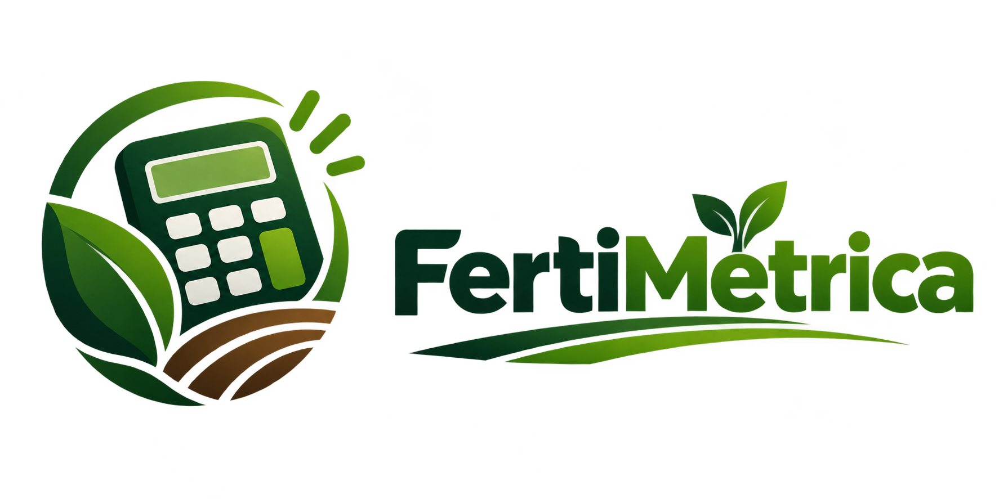

# FertiMetrica



## Sobre o projeto

O FertiMetrica é uma ferramenta web gratuita desenvolvida para auxiliar técnicos agrícolas, engenheiros agrônomos e estudantes da área de Ciências Agrárias na realização de cálculos relacionados à fertilidade do solo e à nutrição vegetal.

A ideia surgiu a partir da formação técnica agrícola do desenvolvedor e da experiência com cálculos de conversão de nutrientes e quantidades de fertilizantes.

O projeto foi desenvolvido na disciplina de Programação para Web do curso de Engenharia de Software da Universidade Tecnológica Federal do Paraná (UTFPR), Campus Dois Vizinhos.

## Objetivo

Facilitar a realização de cálculos agrícolas por meio de uma interface simples, responsiva e acessível, reduzindo o tempo necessário para a realização de conversões e cálculos manuais.

## Funcionalidades

### Conversor de nutrientes

- Conversão entre diferentes formas químicas dos nutrientes.
- Conversão entre unidades de medida: mg/dm³, kg/ha e cmolc/dm³, quando aplicável.
- Conversões envolvendo nitrogênio, fósforo, potássio, cálcio, magnésio e enxofre.
- Apresentação da memória de cálculo.

### Calculadora de fertilizantes

- Seleção de fertilizantes previamente cadastrados.
- Possibilidade de informar fertilizantes personalizados.
- Ajuste da concentração do nutriente.
- Cálculo da quantidade de fertilizante por hectare.
- Cálculo da quantidade total conforme a área de aplicação.

### Consulta de propriedades do solo

Integração com a API pública SoilGrids para consultar estimativas das propriedades do solo:

- Argila;
- Areia;
- Silte;
- pH em água.

A consulta pode ser realizada mediante coordenadas geográficas informadas manualmente ou utilizando a localização do dispositivo.

### Recursos complementares

- Interface responsiva.
- Instruções de utilização.
- Exemplos de cálculos.
- Conteúdo educativo sobre fertilidade do solo.
- Perguntas frequentes.
- Referências técnicas.
- Cópia dos resultados para a área de transferência.
- Armazenamento local da ferramenta selecionada.
- Espaço reservado para publicidade.

## Tecnologias utilizadas

- HTML5
- CSS3
- JavaScript puro
- SoilGrids API
- Git
- GitHub
- GitHub Pages

O projeto é executado diretamente no navegador, sem a utilização de frameworks, bibliotecas externas de JavaScript ou backend próprio.

## Como executar localmente

Clone o repositório:

```bash
git clone https://github.com/LucasBueno01/FertiMetrica.git
```

Acesse o diretório:

```bash
cd FertiMetrica
```

Inicie um servidor HTTP local:

```bash
python3 -m http.server 8000
```

Acesse pelo navegador:

http://localhost:8000

## Acesso ao projeto

O projeto está disponibilizado por meio do GitHub Pages:

https://lucasbueno01.github.io/FertiMetrica/

## Referências técnicas

- Sociedade Brasileira de Ciência do Solo — Núcleo Estadual Paraná (SBCS-NEPAR). Manual de Adubação e Calagem para o Estado do Paraná. Capítulo 6 — Adubos e inoculantes.
- [Embrapa — Empresa Brasileira de Pesquisa Agropecuária](https://www.embrapa.br/)
- [ISRIC — World Soil Information (SoilGrids)](https://soilgrids.org/)

## Considerações importantes

Os resultados apresentados pelo FertiMetrica possuem caráter matemático e não constituem recomendações de adubação.

Os dados disponibilizados pelo SoilGrids são estimativas obtidas por modelagem digital e não substituem análises laboratoriais de solo, mas sim, auxilia na interpretação delas.

A utilização dos resultados em atividades agrícolas deve considerar a avaliação de um profissional habilitado.

## Desenvolvedor

**Lucas Bueno dos Santos**

- Técnico Agrícola.
- Acadêmico de Engenharia de Software.
- UTFPR — Campus Dois Vizinhos.

[GitHub](https://github.com/LucasBueno01) |
[Portfólio pessoal da disciplina web1](https://lucasbueno01.github.io/portfolioAtvWeb/03_responsivo/)

---

2026
